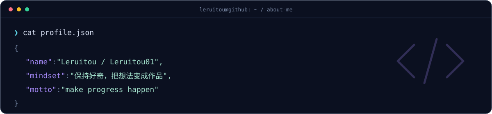



 

**你好，我是 Leruitou。欢迎进入我的数字空间。**

&nbsp;

  

### 🛸 / access granted

 

<table>
<tr>
<td width="50%" valign="top">

### 🧩 / code space

每一个想法，都可以从第一次提交开始。

探索、尝试，然后再向前走一步。

**[打开我的仓库 ↗](https://github.com/Leruitou01?tab=repositories)**

</td>
<td width="50%" valign="top">

### 🍃 / another portal

代码之外，也在社区里留下足迹。

在 FairyMC 找到另一个我。

**[前往 FairyMC ↗](https://www.fairymc.cn/profile/Leruitou)**

</td>
</tr>
</table>

### ⚡ / contribution signal

 

 

`STAY CURIOUS` &nbsp; ✦ &nbsp; `KEEP CREATING` &nbsp; ✦ &nbsp; `MAKE PROGRESS HAPPEN`

感谢来访 · See you in the next commit.

