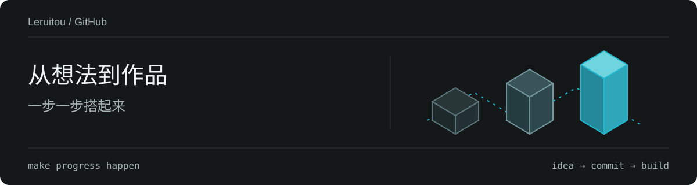

<div align="center">



<br />

**你好，我是 Leruitou 👋**

把想法慢慢变成作品，让每一次尝试都有一点进步。

<a href="https://github.com/Leruitou01"></a>
&nbsp;
<a href="https://www.fairymc.cn/profile/Leruitou"></a>

<br />
<br />

</div>

### ✦ About me

```text
  Leruitou / Leruitou01
  ──────────────────────────────────────
  一点好奇心，一些新想法，持续探索中。
  make progress happen.
```

### ✦ Find me

| 入口 | 去看看 |
| :--- | :--- |
| 🧩 代码与仓库 | [Leruitou01 on GitHub](https://github.com/Leruitou01?tab=repositories) |
| 🍃 社区个人页 | [Leruitou on FairyMC](https://www.fairymc.cn/profile/Leruitou) |

### ✦ GitHub activity

<a href="https://github.com/Leruitou01?tab=overview"></a>

<br />

<div align="center">
  <sub>Thanks for stopping by · 感谢来访 ✨</sub>
</div>
